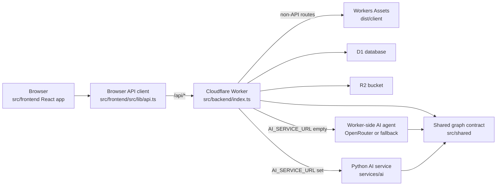

# Open Roadmap Documentation

This directory documents how the current Open Roadmap codebase is wired. The
docs are organized by the part of the system a contributor is most likely to
touch.

## Documentation Map

| Document | Use it when |
| --- | --- |
| [Backend Architecture](./backend-architecture.md) | You need the Worker, Hono routes, D1/R2 model, API reference, or auth behavior. |
| [Frontend Architecture](./frontend-architecture.md) | You are changing `src/frontend`, routes, screens, state hooks, styling, or the React Flow workspace. |
| [Graph Contract](./graph-contract.md) | You are changing graph node/edge shapes, type definitions, React Flow adapters, AI graph output, or persistence. |
| [AI Agent and Service](./ai-agent-and-service.md) | You are wiring AI chat, changing OpenRouter/Python service behavior, or debugging agent graph writes. |
| [Development and Operations](./development-operations.md) | You are setting up the project, running local services, applying D1 migrations, or preparing deployment. |

## System Overview

The production frontend is the Figma-derived React app in `src/frontend`.
The Worker serves its built assets from `dist/client` and runs all `/api/*`
requests before falling through to assets.

## Current Source Ownership

| Area | Primary files |
| --- | --- |
| Worker entry and routing | `src/backend/index.ts`, `src/backend/routes/*` |
| Auth | `src/backend/auth.ts`, `src/backend/routes/profile.ts`, `src/frontend/src/app/auth/*` |
| D1 access and persistence | `src/backend/db/queries.ts`, `migrations/*.sql` |
| Graph validation | `src/shared/graph.ts`, `src/shared/types.ts` |
| Frontend routing | `src/frontend/src/app/App.tsx` |
| Workspace graph state | `src/frontend/src/app/graph/useWorkspaceGraph.ts` |
| Graph adapter | `src/frontend/src/app/graph/adapter.ts` |
| Artifacts | `src/backend/routes/artifacts.ts`, `src/backend/services/artifacts.ts`, `src/frontend/src/app/graph/useWorkspaceArtifacts.ts` |
| AI agent | `src/backend/routes/agent.ts`, `src/backend/ai/*`, `services/ai/app/*` |
| Styling and primitives | `src/frontend/src/styles/*`, `src/frontend/src/app/components/ui/*` |

## How To Keep Docs Current

When changing the codebase, update the docs using this checklist:

1. Route or API changes: update [Backend Architecture](./backend-architecture.md) and any frontend client notes in [Frontend Architecture](./frontend-architecture.md).
2. Graph shape, metadata, type definitions, node handles, or validation changes: update [Graph Contract](./graph-contract.md).
3. UI screen composition, auth routing, workspace panels, or design token changes: update [Frontend Architecture](./frontend-architecture.md).
4. AI request/response, tool calls, artifact loading, or Python service contract changes: update [AI Agent and Service](./ai-agent-and-service.md).
5. New commands, bindings, secrets, migrations, or deployment steps: update [Development and Operations](./development-operations.md).

## Current Known Gaps

These are documented because they affect future implementation choices:

- `src/frontend/src/app/components/AIChat.tsx` is currently UI-only. It does
  not call `/api/roadmaps/:id/agent/messages`.
- The database supports `file`, `link`, and `text` artifact kinds, but the
  current browser flow only uploads files.
- Graph writes are whole-graph replacements. There are no incremental
  node/edge mutation endpoints.
- AI conversation history is stored but not exposed through a read endpoint.
- Custom graph type creation exists on the backend, but the current
  `src/frontend` workspace UI only exposes the default node and edge types.

