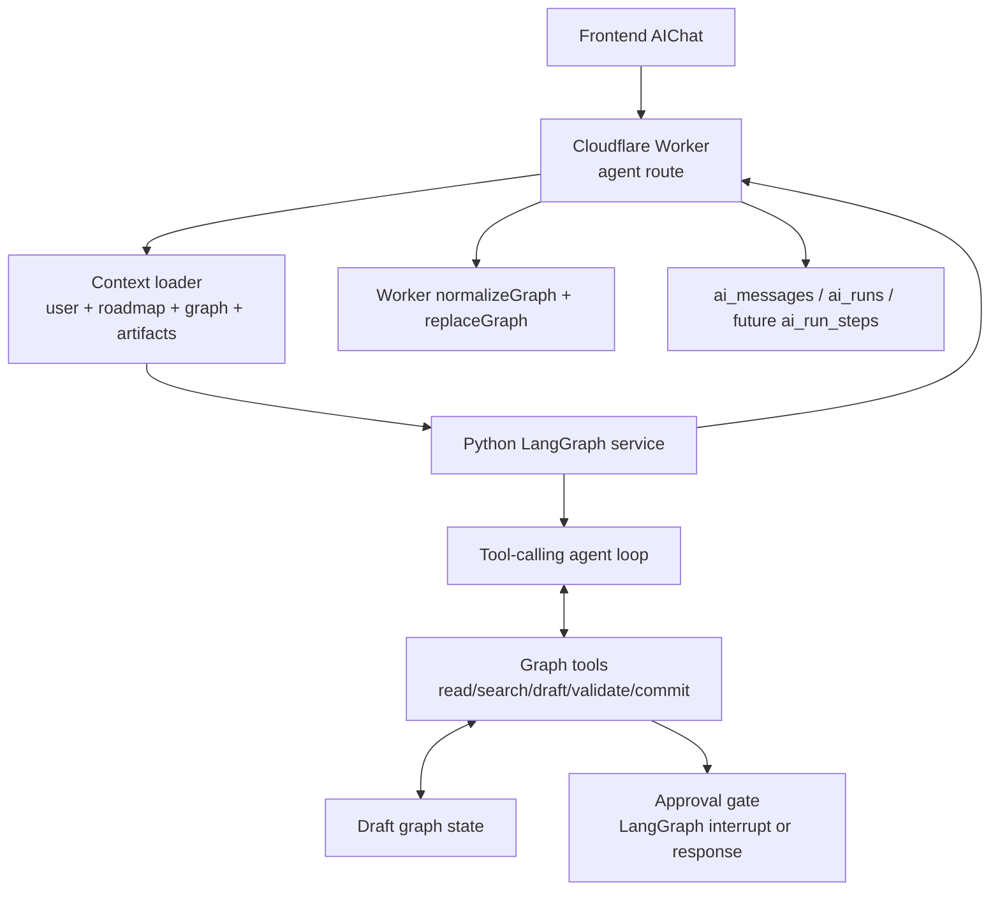
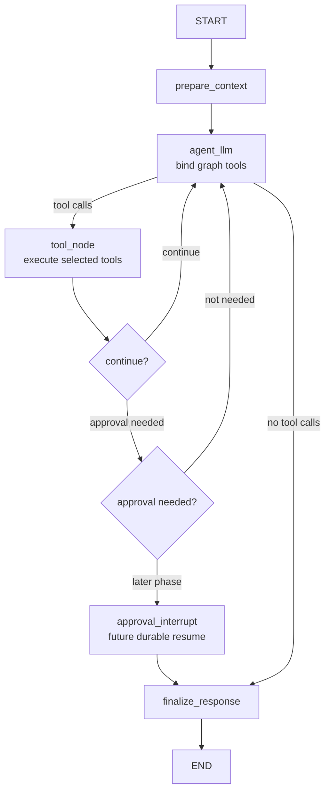

# Graph Copilot Agent Architecture

This document replaces the earlier workflow-first agent design. The target
agent is a **tool-calling graph copilot**: it treats a roadmap graph as a live
knowledge base, chooses tools dynamically, observes tool results, updates a
draft graph when needed, validates the draft, and reports back to the user.

The important shift is:

```text
Old framing: route intent -> generate GraphOperationBatch -> apply -> validate
New framing: agent loop -> read/search/draft/validate/commit tools -> report
```

`GraphOperationBatch` can still exist, but only as an internal implementation
format inside write tools. It should not replace the top-level agent loop.

## Research Basis

The architecture is based on current agent implementations and platform docs:

| System | Relevant pattern | Source |
| --- | --- | --- |
| Claude Code | Agentic loop of gather context, take action, verify; tools for files, search, execution, web; sessions, permissions, checkpoints, compaction, skills, subagents. | [How Claude Code works](https://code.claude.com/docs/en/how-claude-code-works) |
| OpenAI Codex | Local/cloud coding agent with sandbox modes, approval policies, memories, subagents, AGENTS.md, skills, MCP, and background work. | [Codex CLI](https://github.com/openai/codex), [Codex sandboxing](https://developers.openai.com/codex/concepts/sandboxing), [Codex approvals](https://developers.openai.com/codex/agent-approvals-security) |
| GitHub Copilot cloud agent | Research, plan, make changes on a branch, run tests in an ephemeral environment, then let the human review and iterate. | [Copilot cloud agent](https://docs.github.com/en/copilot/concepts/agents/cloud-agent/about-cloud-agent) |
| OpenClaw / Pi | Embedded agent session, custom tool injection, session persistence, branching, compaction, provider failover, sandbox-aware tool wiring. | [OpenClaw Pi architecture](https://github.com/openclaw/openclaw/blob/main/docs/pi.md) |
| Hermes Agent | Central tool registry, toolsets, persistent memory, session search, skills, terminal backends, approvals, interrupt-and-redirect, platform gateway. | [Hermes architecture](https://hermes-agent.nousresearch.com/docs/developer-guide/architecture), [Tools and toolsets](https://hermes-agent.nousresearch.com/docs/user-guide/features/tools/), [Persistent memory](https://github.com/NousResearch/hermes-agent/blob/main/website/docs/user-guide/features/memory.md) |
| LangGraph | Workflows have predetermined paths; agents dynamically define tool usage; persistence and interrupts support resumable human-in-the-loop runs. | [Workflows and agents](https://docs.langchain.com/oss/python/langgraph/workflows-agents), [Interrupts](https://docs.langchain.com/oss/python/langgraph/interrupts), [Persistence](https://docs.langchain.com/oss/python/langgraph/persistence) |
| Anthropic agent guidance | Successful agents are often simple tool loops with clear agent-computer interfaces, environmental feedback, and human checkpoints. | [Building effective agents](https://www.anthropic.com/engineering/building-effective-agents) |

## Product Goal

Open Roadmap needs an agent that can:

1. Answer questions from a roadmap graph as a knowledge graph.
2. Create a useful first graph from a user goal and selected artifacts.
3. Edit an existing graph while preserving user work.
4. Explain what changed and why.
5. Ground answers and graph changes in nodes, edges, and artifacts.
6. Pause for user approval when edits are risky.

The agent should feel like a graph-native collaborator, not a batch graph
generator.

## Core Architecture



The Worker remains the persistence boundary:

- It authenticates the user.
- It checks roadmap ownership.
- It loads the current graph and selected artifacts.
- It calls the Python service when `AI_SERVICE_URL` is configured.
- It validates the returned graph through `normalizeGraph` / `replaceGraph`.
- It records messages, operations, and run metadata.

The Python service owns reasoning:

- It runs a LangGraph-backed tool-calling loop.
- It exposes graph tools to the model.
- It maintains an in-memory draft graph for the run.
- It validates, critiques, and repairs draft changes.
- It returns a response with graph, citations, tool trace, and approval status.

The TypeScript Worker-side agent remains the learning/fallback path:

- It should keep the same tool vocabulary.
- It can implement the loop from scratch without LangGraph.
- It should use the same request/response contract where practical.

## Design Principles

### 1. Agent Loop First

The model should choose tools dynamically based on the user's request and tool
observations.

For example:

```text
User: Explain this roadmap.
Agent: read_graph -> search_graph -> final answer with citations

User: Draw a roadmap for learning distributed systems.
Agent: read_graph -> scaffold_graph_from_objective -> validate_graph -> final report
Service finalize: validate draft -> commit valid candidate

User: Add evidence from this PDF to the backend milestone.
Agent: search_graph -> start_graph_draft -> read_artifact -> attach_artifact -> validate_graph -> final report
Service finalize: validate draft -> commit valid candidate
```

Workflow nodes still matter, but they should wrap the loop with setup,
persistence, approval, and observability rather than replacing model-directed
tool use.

### 2. The Graph Is The Environment

Do not treat the roadmap graph as a large prompt blob. The agent should query it
like an environment:

- `read_graph` for compact whole-graph summaries.
- `search_graph` for relevant subgraphs.
- `read_node` for node detail and neighbors.
- `read_artifact` for grounding evidence.
- `diff_graph` for understanding draft changes.

### 3. Write Tools Edit Draft State

Write tools should not write to D1/R2 directly. They mutate a draft graph inside
the current run.

```text
write tool call -> mutate draft graph -> normalize/validate -> return observation
```

The final save still happens through the Worker. This keeps production data
behind the existing ownership and graph-contract boundary.

### 4. Commit Is Explicit

The model should not own commit responsibility. It edits and validates the
draft; the Python service finalizes the run by validating the draft, applying
approval policy, and marking a valid candidate for the Worker to persist. The
Worker performs the actual database write.

This mirrors coding agents that edit a working tree first, run checks, then ask
for review or commit.

### 5. Approval Gates Are Part Of The Tool System

Risky changes should trigger approval before commit:

- deleting many nodes or edges,
- changing a published roadmap,
- exposing private artifact details,
- introducing custom public-facing type definitions,
- low-confidence large rewrites,
- changing evidence relationships.

The first implementation can return `approvalRequest` without true resume. A
later version should use LangGraph interrupts with a durable checkpointer.

### 6. Context Must Stay Bounded

Follow the Claude Code, Codex, OpenClaw, and Hermes pattern:

- keep stable project rules in docs,
- keep memory small and curated,
- load skills on demand,
- retrieve subgraphs instead of injecting everything,
- summarize noisy tool outputs,
- persist traces outside the prompt.

## Tool Catalog

The tool interface is the agent-computer interface. Tool names and descriptions
should be precise enough that the model can choose them without guessing.

### Read Tools

| Tool | Purpose | Mutates draft |
| --- | --- | --- |
| `read_graph` | Return a compact graph overview, types, counts, key paths, and current draft status. | No |
| `search_graph` | Retrieve a relevant subgraph by semantic query, node type, artifact ID, or relationship. | No |
| `read_node` | Return one node with neighbors, connected edges, and attached artifacts. | No |
| `read_edge` | Return edge detail and source/target summaries. | No |
| `list_graph_types` | Return available node and edge type definitions. | No |
| `read_artifact` | Return selected artifact metadata and available snippets/digests. | No |
| `diff_graph` | Compare committed graph and current draft graph. | No |

### Draft Write Tools

| Tool | Purpose | Notes |
| --- | --- | --- |
| `start_graph_draft` | Start a draft by copying the current roadmap graph. | Use before editing an existing graph. |
| `scaffold_graph_from_objective` | Create a new scaffold draft graph from a high-level objective. | Use for new roadmap creation. |
| `update_graph_draft` | Apply a batch of graph edits to the draft. | Useful for multi-node edits. Internally uses operation DSL. |
| `create_node` | Add one node to the draft. | Validate type and ID uniqueness. |
| `update_node` | Patch one node's type, title, description, status, position, or metadata. | Preserve unspecified fields. |
| `delete_node` | Delete one node and cascade connected edges. | Risk score required. |
| `create_edge` | Add one typed edge to the draft. | Validate endpoints and edge kind. |
| `update_edge` | Patch edge label, type, kind, or metadata. | Preserve source/target unless explicitly supported. |
| `delete_edge` | Delete one edge. | Risk score required. |
| `attach_artifact` | Create or update evidence linkage between artifact and node. | Must reference selected or existing artifact. |
| `detach_artifact` | Remove evidence linkage. | Risk score required. |
| `create_node_type` | Add custom node type to draft. | Approval may be required. |
| `create_edge_type` | Add custom edge type to draft. | Approval may be required. |
| `layout_graph` | Compute or patch node positions. | Deterministic layout preferred. |

### Validation And Commit Tools

| Tool | Purpose |
| --- | --- |
| `validate_graph` | Run schema, contract, policy, preservation, evidence, and layout checks. |
| `critique_graph` | Score graph usefulness, clarity, evidence grounding, and edge semantics. |
| `repair_graph` | Apply safe repair edits after validation/critique failures. |
| `request_approval` | Produce an approval payload for risky changes. |

Commit is an internal finalization step, not a model-facing tool. This keeps the
model focused on graph edits while the service owns validation, approval policy,
and persistence handoff.

### Memory And Skill Tools

These are later-phase tools, not first implementation requirements:

| Tool | Purpose |
| --- | --- |
| `load_agent_skill` | Load project-specific guidance for tasks such as evidence mapping or public portfolio polish. |
| `remember_agent_lesson` | Store bounded, non-sensitive lessons such as accepted graph patterns. |
| `search_past_runs` | Retrieve prior agent runs and accepted/rejected operation patterns. |

## Tool Semantics

Every tool should return a compact observation:

```json
{
  "ok": true,
  "tool": "create_node",
  "result": {
    "nodeId": "milestone-api-foundations",
    "changed": true,
    "validation": "pass"
  },
  "warnings": [],
  "nextRecommendedTools": ["create_edge", "validate_graph"]
}
```

Tool errors should be recoverable:

```json
{
  "ok": false,
  "tool": "create_edge",
  "error": "target node not found: milestone-unknown",
  "recoverable": true,
  "nextRecommendedTools": ["search_graph", "create_node"]
}
```

This gives the LLM environmental feedback, which is the core of the agent loop.

## Internal Operation DSL

High-level write tools may use a typed operation DSL internally:

```python
class GraphOperation(BaseModel):
    op: Literal[
        "create_node",
        "update_node",
        "delete_node",
        "create_edge",
        "update_edge",
        "delete_edge",
        "attach_artifact",
        "detach_artifact",
        "layout_graph",
        "create_node_type",
        "create_edge_type",
    ]
    args: dict[str, Any]
    rationale: str
    confidence: float = Field(ge=0, le=1)
```

This DSL is not the agent's top-level output. It is the safe execution format
inside scaffold and batch draft tools.

## LangGraph Runtime Design

Use LangGraph as the agent harness, not as a rigid graph-generation pipeline.



### State

```python
class AgentState(TypedDict):
    request: RoadmapAgentRequest
    messages: list[Any]
    current_graph: RoadmapGraph
    draft_graph: RoadmapGraph | None
    selected_artifacts: list[ArtifactSummary]
    working_set: GraphWorkingSet | None
    committed_candidate: RoadmapGraph | None
    tool_events: list[AgentToolEvent]
    citations: list[GraphCitation]
    risk_flags: list[RiskFlag]
    validation_report: ValidationReport | None
    approval_request: ApprovalRequest | None
    final_response: RoadmapAgentResponse | None
```

State should store raw data. Prompts should be formatted on demand inside nodes.

### Nodes

| Node | Responsibility |
| --- | --- |
| `prepare_context` | Build stable system prompt inputs, initialize draft graph to `None`, load selected artifacts metadata. |
| `agent_llm` | Call the model with graph tools and current messages. |
| `tool_node` | Dispatch model tool calls to graph tools, update state, append observations. |
| `approval_gate` | Convert risky tool results into `approvalRequest` or interrupt. |
| `finalize_response` | Produce the final contract from state, including graph, response type, citations, and tool trace. |

### Routing

The model decides tool use. Deterministic routing only decides:

- whether tool calls exist,
- whether approval is required,
- whether max iterations or error limits were reached,
- whether final response can be produced.

## Request And Response Contract

The current Python service contract remains backward compatible, but the target
response should be more explicit.

```python
class RoadmapAgentResponse(BaseModel):
    responseType: Literal[
        "answer",
        "graph_update",
        "answer_and_graph_update",
        "clarification",
        "approval_required",
        "error",
    ]
    summary: str
    graph: RoadmapGraph
    committed: bool = False
    operations: list[AgentOperation] = Field(default_factory=list)
    citations: list[GraphCitation] = Field(default_factory=list)
    riskFlags: list[RiskFlag] = Field(default_factory=list)
    validationReport: ValidationReport | None = None
    approvalRequest: ApprovalRequest | None = None
    model: str
```

`summary` remains for compatibility with the existing Worker route and frontend
shape. New clients should use `responseType`, `citations`, and `committed` to
render richer UI.

```python
class AgentOperation(BaseModel):
    id: str
    tool: str
    args: dict[str, Any]
    result: dict[str, Any]
    status: Literal["success", "error", "skipped", "approval_required"]
    startedAt: int
    completedAt: int
```

```python
class GraphCitation(BaseModel):
    kind: Literal["node", "edge", "artifact", "subgraph"]
    id: str
    title: str | None = None
    relevance: str
    confidence: float = Field(ge=0, le=1)
```

## Core User Flows

### Graph Question Answering

```text
User: What is the weakest part of this roadmap?
Agent: read_graph
Agent: search_graph(query="weakest or least supported milestones")
Agent: read_node(node_id=...)
Agent: final answer with node/edge/artifact citations
```

Expected response:

- `responseType = "answer"`
- `committed = false`
- `operations` contains read tool events only
- `graph` is unchanged
- `citations` point to nodes, edges, or artifacts

### New Graph Creation

```text
User: Create a roadmap for becoming a backend engineer.
Agent: read_graph
Agent: list_graph_types
Agent: scaffold_graph_from_objective
Agent: validate_graph
Agent: layout_graph
Agent: final report
Service finalize: validate draft and commit valid candidate
```

Expected response:

- `responseType = "graph_update"`
- `committed = true`
- `graph` is the committed candidate
- `operations` shows draft, validation, layout, and service finalization

### Existing Graph Edit

```text
User: Add API security as a milestone before deployment.
Agent: search_graph(query="deployment milestone")
Agent: create_node
Agent: create_edge
Agent: validate_graph
Agent: final report
Service finalize: validate draft and commit valid candidate
```

Expected response:

- Preserves unrelated graph state.
- Adds minimal nodes/edges.
- Explains changed node IDs and rationale.

### Risky Edit

```text
User: Delete everything except this one milestone.
Agent: read_graph
Agent: diff_graph
Agent: request_approval
Agent: final approval request
```

Expected response:

- `responseType = "approval_required"`
- `committed = false`
- `approvalRequest` describes the destructive diff
- Worker does not persist the draft

## Graph Retrieval Strategy

Start simple and make retrieval smarter only when graph size requires it.

### Phase 1 Retrieval

- Deterministic keyword search over node titles/descriptions.
- Neighbor expansion by 1-2 hops.
- Artifact ID matching.
- Type filters.

### Phase 2 Retrieval

- In-memory embeddings for nodes, edges, and artifact digests inside the Python
  service request.
- Top-k subgraph retrieval.
- Citation ranking.

### Phase 3 Retrieval

- Persist artifact digests and node embeddings in a dedicated store.
- Add accepted/rejected agent run traces to retrieval.
- Use retrieval for memory-like project conventions.

## Safety Model

| Layer | Rule |
| --- | --- |
| Tool availability | Expose only graph tools needed for the current product surface. |
| Draft isolation | Write tools mutate draft state, not D1/R2. |
| Schema validation | Every write tool normalizes/validates after mutation. |
| Policy validation | Destructive or public-facing changes raise risk flags. |
| Approval | Risky commits require explicit approval or interrupt. |
| Persistence | Worker is the only component that writes the final graph. |
| Audit | Store tool events in `ai_runs.operations_json`; later add `ai_run_steps`. |

## Observability

Every run should record:

- model and provider,
- response type,
- tool call sequence,
- tool success/error counts,
- graph diff summary,
- validation result,
- approval status,
- citations,
- token usage and latency when available.

The frontend should eventually render:

- assistant answer,
- citations,
- "changed nodes/edges" summary,
- approval prompt for risky edits,
- operation history for debugging.

## Memory And Skills

Do not add broad memory in the first implementation. The safe path is:

1. Keep product rules in docs and prompts.
2. Add run-local memory only inside `AgentState`.
3. Add curated, bounded project memory later.
4. Add skills as explicit markdown procedures, loaded on demand.

Good future skills:

- `graph-qa`: answer from roadmap graph with citations.
- `roadmap-seeding`: create first graph from goal + artifacts.
- `evidence-grounding`: map artifacts to progress/evidence nodes.
- `portfolio-polish`: improve public readability without overstating evidence.

## Python File Layout

Target layout:

```text
services/ai/app/
  main.py
  schemas.py
  agent.py
  graph_agent/
    __init__.py
    state.py
    workflow.py
    prompts.py
    tools.py
    graph_tools.py
    retrieval.py
    validation.py
    diff.py
    layout.py
    risk.py
    models.py
```

Responsibilities:

| File | Responsibility |
| --- | --- |
| `workflow.py` | Build and compile the LangGraph agent loop. |
| `state.py` | Define `AgentState` and internal state helpers. |
| `tools.py` | Register tool definitions and LangChain/LangGraph tool wrappers. |
| `graph_tools.py` | Implement read/search/draft/write/commit tool handlers. |
| `retrieval.py` | Build graph summaries and subgraph search. |
| `validation.py` | Mirror `normalizeGraph` behavior and add policy checks. |
| `diff.py` | Produce graph diff summaries for approval and reporting. |
| `layout.py` | Deterministic layout helpers. |
| `risk.py` | Score destructive/public/private changes. |
| `models.py` | OpenRouter-compatible model factory and model routing. |

## TypeScript Local Agent Alignment

The Worker-side local agent should evolve toward the same shape:

```text
src/backend/ai/local-agent/
  index.ts
  state.ts
  openrouter.ts
  tools.ts
  graph-tools.ts
  prompts.ts
  validation.ts
  fallback.ts
```

It should still be scratch-built for learning. The important shared pieces are:

- same tool names,
- same operation trace shape,
- same safety rules,
- same final response contract,
- same graph contract.

## Implementation Plan

### Phase 1: Contract And Tool Skeleton

- Add target response fields as optional/backward-compatible fields.
- Define Python `AgentState`.
- Implement deterministic tools:
  - `read_graph`
  - `search_graph`
  - `start_graph_draft`
  - `scaffold_graph_from_objective`
  - `create_node`
  - `create_edge`
  - `validate_graph`
- Keep the existing fallback graph behavior available through
  `scaffold_graph_from_objective`.
- Add Python tests for tool handlers and response shape.

### Phase 2: LangGraph Tool Loop

- Add LangGraph dependencies.
- Build `prepare_context -> agent_llm -> tool_node -> finalize_response`.
- Use OpenRouter-compatible chat model.
- Cap iterations.
- Return read-only answers without graph commits.
- Return graph edits only after service-side finalization validates the draft.

### Phase 3: Graph QA With Citations

- Implement better `search_graph`.
- Add `GraphCitation`.
- Teach the agent to cite nodes, edges, and artifacts.
- Update frontend response rendering.

### Phase 4: Approval And Resume

- Add risk scoring.
- Return `approvalRequest` for risky edits.
- Later add LangGraph interrupts and durable checkpointer.
- Add frontend approval UI.

### Phase 5: Evaluation

- Add fixtures:
  - empty graph seeding,
  - graph explanation,
  - targeted expansion,
  - evidence attachment,
  - risky deletion,
  - ambiguous request.
- Add deterministic checks:
  - graph validates,
  - no dangling edges,
  - unrelated nodes preserved,
  - citations reference existing graph/artifacts.
- Add LLM-as-judge checks later:
  - answer groundedness,
  - roadmap usefulness,
  - edge semantic quality,
  - non-destructiveness.

### Phase 6: Memory, Skills, And Subagents

- Add curated project memory only after core loop is reliable.
- Add on-demand graph skills.
- Add subagents only for large independent read-heavy tasks such as artifact
  extraction or portfolio critique.

## Non-Goals

- The Python service should not write directly to D1/R2.
- The model should not emit raw full-graph JSON as the normal mutation path.
- The first version should not require vector databases, durable checkpointers,
  or multi-agent delegation.
- The first version should not expose arbitrary shell/browser tools.

## Acceptance Criteria

The first real implementation is acceptable when:

1. A graph question can be answered without modifying the graph.
2. A new graph can be created through tool calls and persisted by the Worker.
3. A targeted edit can preserve unrelated graph state.
4. The response includes tool events and a concise user-facing summary.
5. Invalid tool calls return recoverable observations.
6. Returned graphs pass the shared graph contract.
7. The architecture remains understandable enough to reimplement in the
   TypeScript local agent from scratch.
