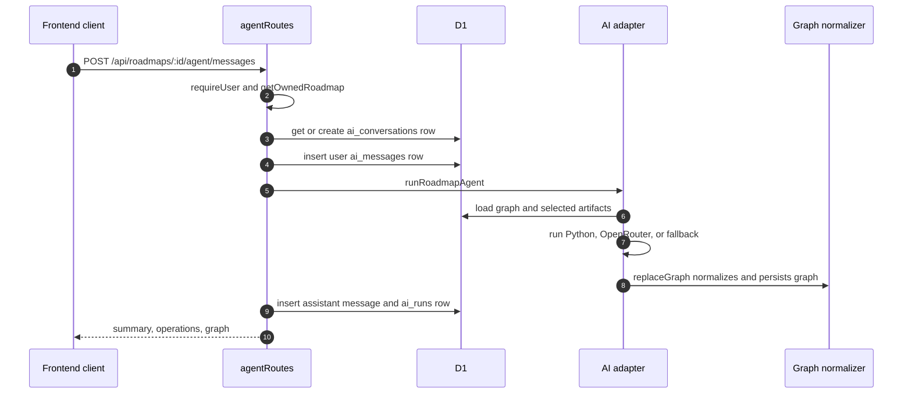

# Open Roadmap AI Agent and Service

This document describes how AI graph generation is currently implemented and
where the frontend integration still needs work.

## Summary

The backend has one AI endpoint:

```text
POST /api/roadmaps/:id/agent/messages
```

That endpoint stores the user's message, runs a roadmap agent, persists the
agent's returned graph through the same graph validation path as manual saves,
stores run metadata, and returns the updated graph.

There are two possible agent backends:

| Backend | Selected when | Implementation |
| --- | --- | --- |
| Python AI service | `AI_SERVICE_URL` is set | `src/backend/ai/python-client.ts` calls `services/ai`. |
| Worker-side agent | `AI_SERVICE_URL` is empty | `src/backend/ai/local-agent.ts` calls OpenRouter or local fallback. |

The current `src/frontend` chat component is not connected to this endpoint.

## Request Lifecycle



If the agent fails, the route inserts a failed `ai_runs` row and returns `500`.

## Endpoint Contract

Request:

```json
{
  "content": "Create a roadmap for becoming a senior frontend engineer.",
  "artifactIds": ["artifact-uuid"]
}
```

Response:

```json
{
  "summary": "Created a roadmap draft.",
  "operations": [
    {
      "tool": "create_node",
      "args": { "id": "objective-main" },
      "result": { "ok": true, "id": "objective-main" }
    }
  ],
  "graph": {
    "nodes": [],
    "edges": [],
    "nodeTypes": [],
    "edgeTypes": []
  }
}
```

The response graph has already passed `replaceGraph`, so it is safe for the
frontend to restore through `toWorkspaceNode` and `toWorkspaceEdge`.

## Agent Selection

`src/backend/ai/index.ts` owns selection:

```ts
if (input.env.AI_SERVICE_URL?.trim()) {
  return runPythonRoadmapAgent(input);
}

return runLocalRoadmapAgent(input);
```

Use `AI_SERVICE_URL` when the real AI workflow should live outside the Worker,
for example when it needs Python libraries, a longer-running service boundary,
or a different deployment lifecycle.

Use the Worker-side agent when the logic should run directly inside the
Cloudflare Worker and can fit within Worker constraints.

## Worker-Side Agent

File: `src/backend/ai/local-agent.ts`

The Worker-side agent performs this flow:

1. Load the current graph with `getGraph`.
2. Load selected artifacts with `loadArtifacts`.
3. If `OPENROUTER_API_KEY` is absent:
   - In production, throw an error.
   - In development, create a fallback starter graph.
4. If `OPENROUTER_API_KEY` is present, call OpenRouter chat completions with
   tool definitions.
5. Apply tool calls to an in-memory draft graph.
6. Normalize and persist the final graph with `replaceGraph`.

### OpenRouter Request

The OpenRouter call:

- Uses `env.OPENROUTER_MODEL` or `openai/gpt-4.1-mini`.
- Sends a system prompt describing graph generation responsibilities.
- Sends selected artifact text or PDF file content.
- Enables the OpenRouter `file-parser` plugin for PDF parsing.
- Disables parallel tool calls with `parallel_tool_calls: false`.
- Allows up to 8 tool-call iterations.

### Tool Calls

The local agent supports these tools:

| Tool | Effect |
| --- | --- |
| `create_node` | Adds a graph node after checking type support and duplicate IDs. |
| `update_node` | Updates node type, title, description, status, position, or metadata. |
| `delete_node` | Deletes a node and all connected edges. |
| `create_edge` | Adds a typed edge between existing nodes. |
| `update_edge` | Updates edge kind, label, or metadata. |
| `delete_edge` | Deletes an edge. |
| `attach_artifact` | Creates an artifact graph node and an `evidences` edge for a selected artifact. |
| `set_layout` | Updates positions for existing nodes. |
| `create_node_type` | Adds a custom node type definition to the draft graph. |
| `create_edge_type` | Adds a custom edge type definition to the draft graph. |

Every tool application calls `normalizeGraph` on the draft. Tool errors are
returned as `{ ok: false, error }` and recorded in operations instead of
crashing the entire loop.

### Development Fallback

When no `OPENROUTER_API_KEY` exists in non-production, the local agent creates
a small starter graph if the graph is empty:

- `objective-main`
- `milestone-first`
- `event-log`
- A `supports` edge.
- A `next` edge.

It may also attach up to three selected artifacts to the event or first node.
The fallback summary explains that an OpenRouter key is needed for real tool
generation.

## Artifact Loading

The local agent accepts up to 6 unique selected artifact IDs. It only loads
artifacts that:

- Belong to the current user.
- Belong to the current roadmap.

Artifact handling:

| Artifact kind | Behavior |
| --- | --- |
| `text` with `text_content` | Sends up to 12000 characters. |
| text-like file (`text/plain`, `text/markdown`, `.txt`, `.md`) | Reads R2 object text and sends up to 12000 characters. |
| PDF file | Sends base64 `data:application/pdf` content to OpenRouter. |
| other file | Sends file metadata only. |

Images are uploadable artifacts, but the current local agent does not inline
image bytes for model vision.

## Python AI Service

Files:

- `services/ai/app/main.py`
- `services/ai/app/agent.py`
- `services/ai/app/schemas.py`
- `src/backend/ai/python-client.ts`

When `AI_SERVICE_URL` is set, the Worker sends:

```json
{
  "userId": "user-id",
  "roadmapId": "roadmap-id",
  "message": "user message",
  "artifactIds": [],
  "artifacts": [],
  "graph": {}
}
```

to:

```text
POST {AI_SERVICE_URL}/roadmap-agent/runs
```

The Python service responds with:

```json
{
  "graph": {},
  "summary": "AI service updated the roadmap.",
  "operations": [],
  "model": "python-ai-service"
}
```

`python-client.ts` normalizes the returned graph against current node and edge
types, persists it with `replaceGraph`, and normalizes operations.

The current Python implementation is a contract skeleton. It returns a fallback
starter graph when the input graph is empty. Replace
`services/ai/app/agent.py::build_graph_response` with the real agent workflow.

## Running The Python Service Locally

```bash
cd services/ai
python -m venv .venv
source .venv/bin/activate
pip install -e .
uvicorn app.main:app --reload --port 8000
```

Then configure the Worker environment:

```text
AI_SERVICE_URL=http://localhost:8000
```

For local Wrangler, this normally belongs in `.dev.vars` or environment-specific
configuration rather than a secret.

## Persistence and Audit Tables

AI route writes:

| Table | Write |
| --- | --- |
| `ai_conversations` | Created once per user/roadmap pair. |
| `ai_messages` | User message before agent run; assistant summary after success. |
| `ai_runs` | Completed or failed run metadata, model, operations JSON, and error text. |
| `roadmap_nodes` / `roadmap_edges` | Replaced by `replaceGraph` after agent output. |

There is currently no read endpoint for conversation history.

## Frontend Integration Gap

Current state:

- Backend endpoint exists.
- Backend persistence exists.
- Main frontend `api` object does not expose `runAgent`.
- `AIChat` only logs and clears input.
- No UI exists for selecting artifacts to include in an AI run.
- No UI exists for displaying assistant summaries or operation history.

Recommended integration sequence:

1. Add `api.runAgent(id, { content, artifactIds })` to
   `src/frontend/src/lib/api.ts`.
2. Pass `roadmapId`, current artifacts, and a graph refresh/apply callback into
   `AIChat`.
3. In `AIChat`, add sending/loading/error state.
4. Before sending, call `graph.ensureGraphSaved()` so the AI sees current nodes.
5. Send selected artifact IDs or an empty array.
6. On success, restore returned graph through `toWorkspaceNode` and
   `toWorkspaceEdge`.
7. Update roadmap list or save state if needed.
8. Add an agent history endpoint only if the UI needs persisted conversation
   replay.

## Failure Modes

| Failure | Current behavior |
| --- | --- |
| Empty message | Route returns `400`. |
| Unauthenticated production request | Route returns `401`. |
| Roadmap not owned by user | Route returns `404`. |
| Python service non-2xx | Route records failed run and returns `500`. |
| OpenRouter non-2xx in production | Route records failed run and returns `500`. |
| OpenRouter failure in development | Falls back to local starter graph. |
| Invalid returned graph | `replaceGraph` or `normalizeGraph` throws; route records failed run. |

## Change Checklist

When modifying AI behavior:

1. Keep all persisted graph output passing `normalizeGraph`.
2. Update both TypeScript and Python graph schemas when the graph contract changes.
3. Document new operation/tool names here.
4. Make artifact loading limits explicit if changed.
5. Add route or adapter tests for new response shapes.
6. Update [Graph Contract](./graph-contract.md) if metadata keys or types change.

