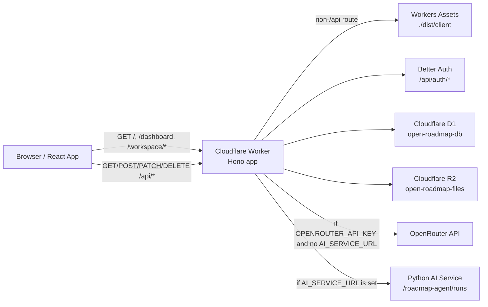
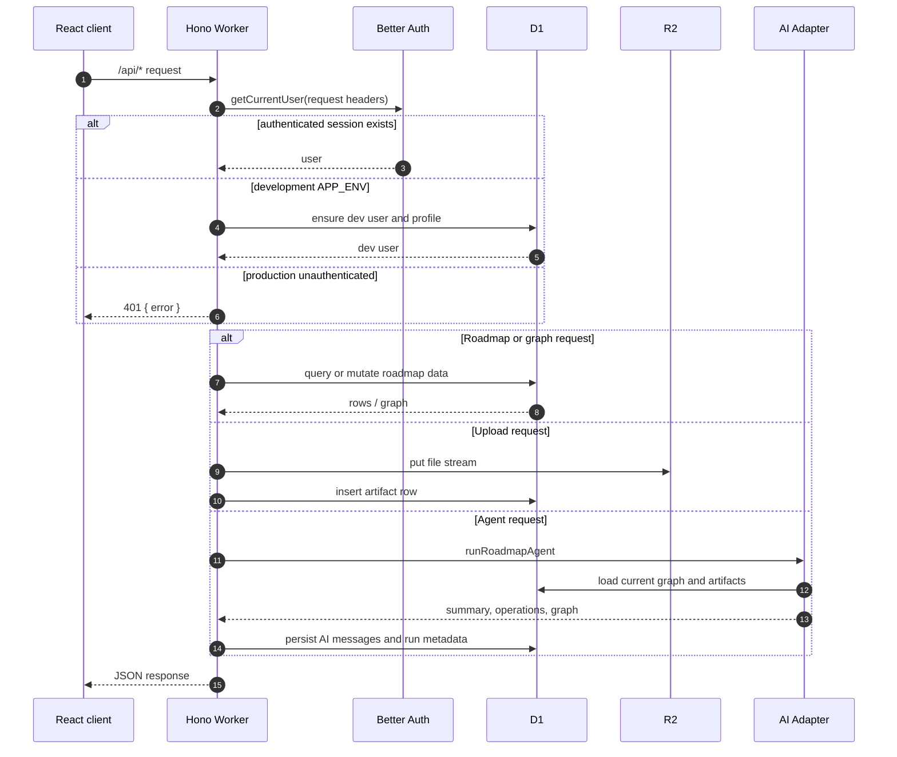
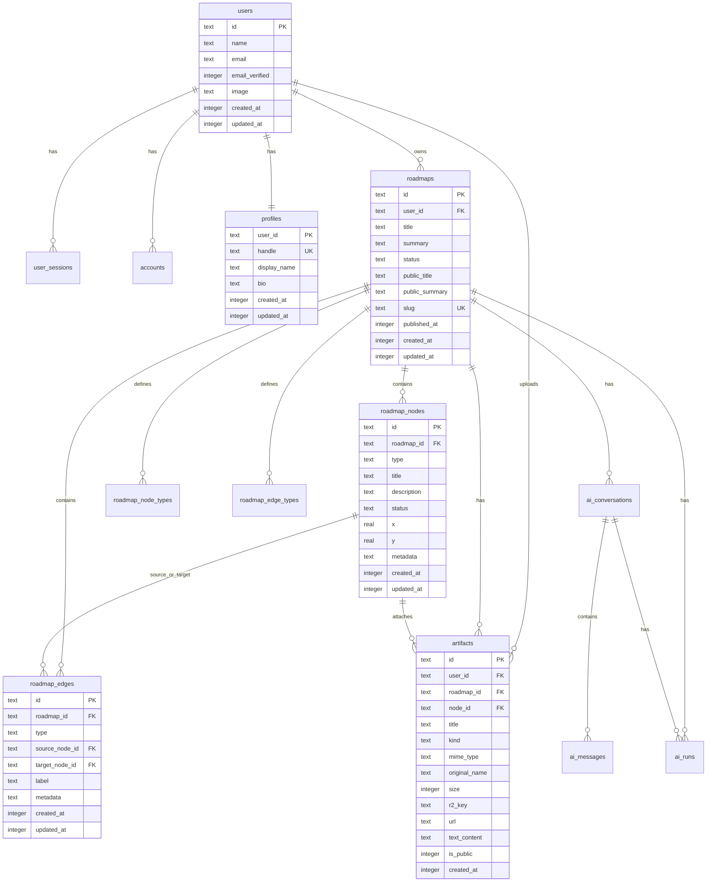
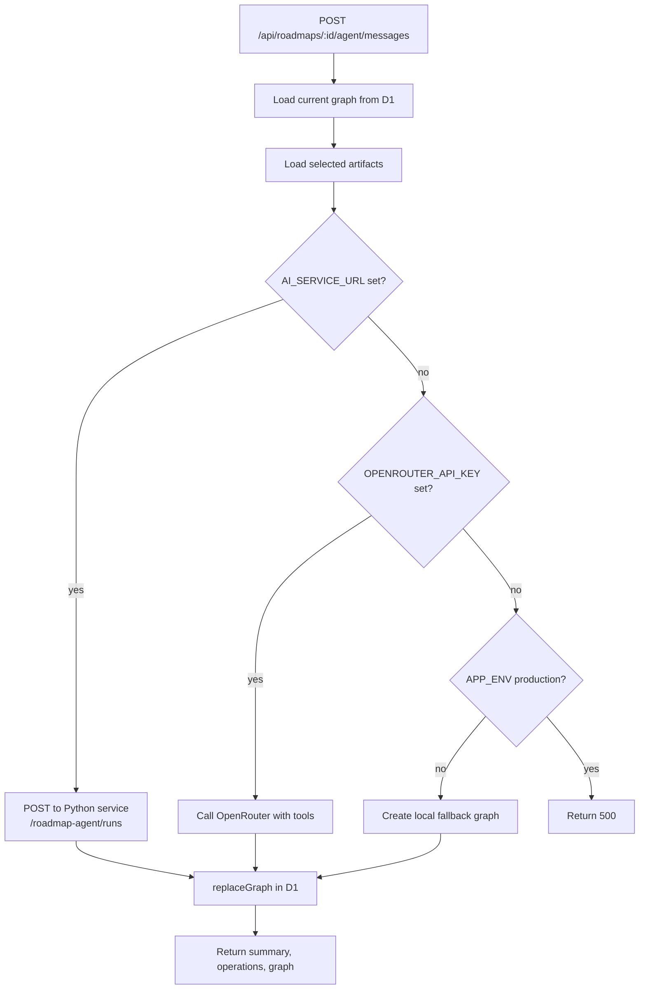

# Open Roadmap Backend Architecture

이 문서는 Open Roadmap 백엔드의 현재 구조, 런타임 구성, API 계약, 데이터 모델, AI Agent 흐름을 설명한다. 기준 코드는 `src/backend`, `src/shared`, `migrations`, `wrangler.jsonc`이다.

## 요약

Open Roadmap 백엔드는 Cloudflare Workers 위에서 실행되는 Hono 애플리케이션이다. Worker는 API 요청을 직접 처리하고, 프론트엔드 정적 에셋은 Wrangler Assets binding을 통해 제공한다.

핵심 책임은 다음과 같다.

- Better Auth 기반 사용자 인증과 개발용 사용자 fallback
- D1 기반 로드맵, 그래프, 타입, 프로필, AI 대화 저장
- R2 기반 파일 업로드와 비공개/공개 파일 제공
- 로드맵 그래프 정규화, 저장, 조회
- OpenRouter 또는 Python AI 서비스에 위임하는 로드맵 Agent 실행
- 공개 프로필과 공개 로드맵 조회 API 제공

## 런타임 구성



### Wrangler bindings

`wrangler.jsonc` defines these runtime bindings:

| Binding | Type | Purpose |
| --- | --- | --- |
| `DB` | D1 database | Users, profiles, roadmaps, graph nodes/edges, artifacts, AI messages/runs |
| `FILES` | R2 bucket | Uploaded files and public/private artifact file retrieval |
| `ASSETS` | Workers Assets | Built frontend under `./dist/client` |

Important vars and secrets:

| Name | Kind | Purpose |
| --- | --- | --- |
| `APP_ENV` | var | `development` enables dev user fallback. `production` requires real auth. |
| `BETTER_AUTH_URL` | var | Public base URL used by Better Auth and OpenRouter referer. |
| `OPENROUTER_MODEL` | var | Model name for the local Worker-side AI adapter. |
| `AI_SERVICE_URL` | var | If set, Worker delegates roadmap agent runs to the Python service. |
| `BETTER_AUTH_SECRET` | secret | Better Auth signing secret. Required in production. |
| `GOOGLE_CLIENT_ID` | secret | Enables Google social login when paired with secret. |
| `GOOGLE_CLIENT_SECRET` | secret | Enables Google social login when paired with client id. |
| `OPENROUTER_API_KEY` | secret | Enables Worker-side OpenRouter agent. |

## Source Layout

```text
src/backend/
  index.ts              Hono routes and request orchestration
  auth.ts               Better Auth setup, current-user lookup, dev fallback
  types.ts              Backend env and shared type re-exports
  db/
    auth-schema.ts      Drizzle schema for Better Auth tables
    queries.ts          D1 query helpers and graph persistence
  ai/
    index.ts            Chooses Python service vs local Worker-side agent
    local-agent.ts      OpenRouter/tool-calling agent and local fallback
    python-client.ts    Delegates to external Python AI service

src/shared/
  types.ts              Shared graph/domain types
  graph.ts              Graph validation, normalization, default type definitions
  graph.test.ts         Graph normalization tests

migrations/
  0001_initial.sql      Auth, profile, roadmap, graph, artifact, AI tables
  0002_graph_type_definitions.sql
                        Per-roadmap node/edge type tables and migration
```

## Request Lifecycle



## Authentication

Authentication is handled by Better Auth under `/api/auth/*`. The Hono app forwards both `GET` and `POST` requests for this prefix to `createAuth(c.env).handler(c.req.raw)`.

Current-user resolution:

1. `getCurrentUser(env, request)` asks Better Auth for a session using request headers.
2. If a session exists, the backend ensures the user has a profile row.
3. If no session exists and `APP_ENV !== "production"`, a deterministic `dev-user` is created and returned.
4. If no session exists in production, protected routes return `401`.

This means local development can use the API without Google OAuth, while production must have a real auth session.

## Module Responsibilities

### `src/backend/index.ts`

Owns HTTP routing and thin request orchestration.

- Reads request body or form data.
- Calls `requireUser` for private routes.
- Checks roadmap ownership with `getOwnedRoadmap`.
- Calls query helpers from `db/queries.ts`.
- Calls the AI adapter for `/agent/messages`.
- Converts thrown errors into JSON responses.
- Falls through to `ASSETS.fetch` for non-API routes.

### `src/backend/db/queries.ts`

Owns database access and shape conversion.

- Converts SQL rows to frontend-facing public objects.
- Lists, creates, updates, and deletes roadmaps.
- Loads and replaces graph nodes/edges.
- Ensures default graph type definitions exist per roadmap.
- Creates custom node and edge type definitions.
- Lists and fetches artifacts.

### `src/shared/graph.ts`

Owns graph contract enforcement.

- Defines default node and edge type definitions.
- Validates allowed type ids.
- Normalizes colors, labels, metadata, positions, graph arrays.
- Rejects invalid graph writes before persistence.
- Ensures edges only connect existing nodes.

This file is the key compatibility layer between frontend React Flow state, backend persistence, and AI agent output.

### `src/backend/ai/*`

Owns roadmap graph generation and mutation.

- `ai/index.ts` chooses the backend:
  - If `AI_SERVICE_URL` is set, call Python AI service.
  - Otherwise use Worker-side local/OpenRouter agent.
- `local-agent.ts` can use OpenRouter tool calls to mutate a draft graph.
- If OpenRouter is not configured in development, local fallback seeds a starter graph.
- `python-client.ts` sends the current graph, selected artifacts, and user message to the Python service and persists the returned graph.

## Data Model



### Important table notes

- `roadmaps.status` is currently `draft | published`.
- `roadmap_nodes.type` and `roadmap_edges.type` were initially constrained to default values in `0001_initial.sql`.
- `0002_graph_type_definitions.sql` adds `roadmap_node_types` and `roadmap_edge_types`, then recreates node/edge tables without static type checks so custom graph types are possible.
- `artifacts.kind` supports `file | link | text`, but the current HTTP route only creates `file` artifacts through `/api/uploads`.
- `ai_messages` stores user and assistant messages. There is no current API route for reading conversation history.
- `ai_runs` stores agent run status, model, tool operations, and error metadata.

## Graph Contract

The backend API and AI service share this graph shape:

```ts
type RoadmapGraph = {
  nodes: Array<{
    id: string;
    type: string;
    position: { x: number; y: number };
    data: {
      title: string;
      description: string;
      status: string;
      metadata: Record<string, unknown>;
    };
  }>;
  edges: Array<{
    id: string;
    source: string;
    target: string;
    type: "smoothstep";
    label?: string;
    data: {
      kind: string;
      label: string;
      metadata: Record<string, unknown>;
    };
  }>;
  nodeTypes: TypeDefinition[];
  edgeTypes: TypeDefinition[];
};
```

Default node types:

| ID | Korean name | Purpose |
| --- | --- | --- |
| `objective` | 목표 | 로드맵이 향하는 핵심 결과 |
| `milestone` | 마일스톤 | 목표를 향한 주요 단계 |
| `event` | 이벤트 | 진행 과정과 회고 기록 |
| `artifact` | 산출물 | 결과물과 증거 자료 |

Default edge types:

| ID | Korean name | Purpose |
| --- | --- | --- |
| `supports` | 기여 | 한 요소가 다른 목표에 기여함 |
| `depends_on` | 의존 | 선행 조건이나 의존 관계 |
| `evidences` | 증거 | 자료가 목표나 이벤트를 증명함 |
| `next` | 다음 | 시간 또는 진행 순서 |

### Validation rules

`normalizeGraph` enforces:

- `nodes` and `edges` must both be arrays.
- Node ids must be present and unique.
- Edge ids must be present and unique.
- Node types must exist in `nodeTypes`.
- Edge `data.kind` must exist in `edgeTypes`.
- Edges must connect existing source and target nodes.
- Node text and edge labels are trimmed and length-limited.
- Metadata must be an object, not an array.
- Missing positions are replaced by deterministic fallback positions.

## API Reference

All private API endpoints use cookie-based auth with `credentials: "include"` on the frontend. JSON endpoints return `{ error: string }` on error.

### Auth and Profile

| Method | Path | Auth | Description |
| --- | --- | --- | --- |
| `GET`, `POST` | `/api/auth/*` | Depends on Better Auth route | Better Auth handler. |
| `GET` | `/api/me` | Required | Returns current user. In development, returns `dev-user` if no session exists. |
| `PATCH` | `/api/profile` | Required | Updates profile handle, display name, and bio. |

#### `GET /api/me`

Response:

```json
{
  "user": {
    "id": "dev-user",
    "name": "Local Developer",
    "email": "dev@open-roadmap.local",
    "image": null,
    "profile": {
      "handle": "local-developer",
      "displayName": "Local Developer",
      "bio": ""
    }
  }
}
```

#### `PATCH /api/profile`

Request:

```json
{
  "handle": "jane-doe",
  "displayName": "Jane Doe",
  "bio": "Frontend engineer building roadmap portfolios."
}
```

Response:

```json
{
  "profile": {
    "handle": "jane-doe",
    "displayName": "Jane Doe",
    "bio": "Frontend engineer building roadmap portfolios."
  }
}
```

### Roadmaps

| Method | Path | Auth | Description |
| --- | --- | --- | --- |
| `GET` | `/api/roadmaps` | Required | Lists owned roadmaps ordered by `updated_at DESC`. |
| `POST` | `/api/roadmaps` | Required | Creates a roadmap and default graph types. |
| `GET` | `/api/roadmaps/:id` | Required | Returns one owned roadmap and its artifacts. |
| `PATCH` | `/api/roadmaps/:id` | Required | Updates title and summary. |
| `DELETE` | `/api/roadmaps/:id` | Required | Deletes roadmap and related graph, artifacts, AI rows. |

#### `POST /api/roadmaps`

Request:

```json
{
  "title": "Career Growth 2026",
  "summary": "A roadmap toward senior frontend work."
}
```

Response:

```json
{
  "roadmap": {
    "id": "uuid",
    "title": "Career Growth 2026",
    "summary": "A roadmap toward senior frontend work.",
    "status": "draft",
    "publicTitle": null,
    "publicSummary": null,
    "slug": null,
    "publishedAt": null,
    "createdAt": 1777110000000,
    "updatedAt": 1777110000000
  }
}
```

List responses include `nodeCount` for dashboard rendering:

```json
{
  "roadmaps": [
    {
      "id": "uuid",
      "title": "Career Growth 2026",
      "summary": "A roadmap toward senior frontend work.",
      "status": "draft",
      "publicTitle": null,
      "publicSummary": null,
      "slug": null,
      "publishedAt": null,
      "createdAt": 1777110000000,
      "updatedAt": 1777110000000,
      "nodeCount": 7
    }
  ]
}
```

### Graphs and Types

| Method | Path | Auth | Description |
| --- | --- | --- | --- |
| `GET` | `/api/roadmaps/:id/graph` | Required | Returns normalized graph for an owned roadmap. |
| `PATCH` | `/api/roadmaps/:id/graph` | Required | Replaces all nodes and edges for a roadmap. |
| `GET` | `/api/roadmaps/:id/types` | Required | Returns node and edge type definitions. |
| `POST` | `/api/roadmaps/:id/types` | Required | Creates one custom node or edge type. |

#### `PATCH /api/roadmaps/:id/graph`

Request:

```json
{
  "graph": {
    "nodes": [
      {
        "id": "objective-main",
        "type": "objective",
        "position": { "x": 80, "y": 140 },
        "data": {
          "title": "Become Senior Frontend Engineer",
          "description": "Advance to a senior role by Q4.",
          "status": "active",
          "metadata": {}
        }
      }
    ],
    "edges": [],
    "nodeTypes": [],
    "edgeTypes": []
  }
}
```

Response:

```json
{
  "graph": {
    "nodes": [],
    "edges": [],
    "nodeTypes": [],
    "edgeTypes": []
  }
}
```

The response graph is normalized. Default type definitions are preserved or inserted if omitted.

#### `POST /api/roadmaps/:id/types`

Request:

```json
{
  "scope": "node",
  "name": "Decision",
  "description": "A branch or decision point",
  "color": "#2c7a6f",
  "icon": "git-branch"
}
```

Response:

```json
{
  "type": {
    "id": "decision",
    "name": "Decision",
    "description": "A branch or decision point",
    "color": "#2c7a6f",
    "icon": "git-branch",
    "isDefault": false,
    "sortOrder": 50
  }
}
```

### Artifacts and Files

| Method | Path | Auth | Description |
| --- | --- | --- | --- |
| `POST` | `/api/uploads` | Required | Uploads one file to R2 and creates an artifact row. |
| `GET` | `/api/artifacts/:id/file` | Optional | Streams a private file for the owner or a public file for anyone. |

#### `POST /api/uploads`

Request body is `multipart/form-data`.

| Field | Required | Description |
| --- | --- | --- |
| `file` | yes | File object. Max size 10 MB. |
| `roadmapId` | no | Roadmap to attach artifact to. Must be owned by the user. |
| `nodeId` | no | Node id to associate with the artifact. |
| `title` | no | Artifact title. Defaults to filename. |

Allowed MIME types:

- `image/jpeg`
- `image/png`
- `image/webp`
- `image/gif`
- `application/pdf`
- `text/plain`
- `text/markdown`

Response:

```json
{
  "artifact": {
    "id": "uuid",
    "title": "Report.pdf",
    "kind": "file",
    "mimeType": "application/pdf",
    "originalName": "Report.pdf",
    "size": 123456,
    "url": null,
    "nodeId": "event-log",
    "isPublic": false,
    "createdAt": 1777110000000,
    "fileUrl": "/api/artifacts/uuid/file"
  }
}
```

### AI Agent

| Method | Path | Auth | Description |
| --- | --- | --- | --- |
| `POST` | `/api/roadmaps/:id/agent/messages` | Required | Stores user message, runs roadmap agent, persists returned graph and run metadata. |

Request:

```json
{
  "content": "I want to become a senior frontend engineer by Q4.",
  "artifactIds": ["artifact-uuid"]
}
```

Response:

```json
{
  "summary": "로드맵 초안을 업데이트했습니다.",
  "operations": [
    {
      "tool": "create_node",
      "args": {},
      "result": { "ok": true, "id": "objective-main" }
    }
  ],
  "graph": {
    "nodes": [],
    "edges": [],
    "nodeTypes": [],
    "edgeTypes": []
  }
}
```

Agent selection:



Local Worker-side agent tools:

| Tool | Purpose |
| --- | --- |
| `create_node` | Adds a graph node. |
| `update_node` | Updates type, text, status, position, metadata. |
| `delete_node` | Deletes a node and connected edges. |
| `create_edge` | Adds a typed edge between existing nodes. |
| `update_edge` | Updates edge kind, label, metadata. |
| `delete_edge` | Deletes an edge. |
| `attach_artifact` | Creates an artifact node and evidence edge for a selected artifact. |
| `set_layout` | Updates node positions. |
| `create_node_type` | Adds a custom node type definition to the graph draft. |
| `create_edge_type` | Adds a custom edge type definition to the graph draft. |

### Publishing and Public APIs

| Method | Path | Auth | Description |
| --- | --- | --- | --- |
| `POST` | `/api/roadmaps/:id/publish` | Required | Marks roadmap as published, assigns unique slug, toggles public artifacts. |
| `GET` | `/api/public/users/:handle` | Public | Returns profile and published roadmaps. |
| `GET` | `/api/public/roadmaps/:slug` | Public | Returns public roadmap, graph, public artifacts, owner profile. |

#### `POST /api/roadmaps/:id/publish`

Request:

```json
{
  "publicTitle": "Career Growth Journey 2026",
  "publicSummary": "A portfolio-style roadmap.",
  "slug": "career-growth-2026",
  "artifactIds": ["artifact-uuid"]
}
```

Response:

```json
{
  "roadmap": {
    "id": "uuid",
    "title": "Career Growth 2026",
    "summary": "A roadmap toward senior frontend work.",
    "status": "published",
    "publicTitle": "Career Growth Journey 2026",
    "publicSummary": "A portfolio-style roadmap.",
    "slug": "career-growth-2026",
    "publishedAt": 1777110000000,
    "createdAt": 1777100000000,
    "updatedAt": 1777110000000
  }
}
```

## Frontend Integration Notes

The backend-facing frontend client should keep a thin API wrapper around `fetch`:

- Always pass `credentials: "include"`.
- Set `Content-Type: application/json` unless body is `FormData`.
- Parse JSON safely.
- Throw an `ApiError` with response status and `{ error }` message on non-2xx responses.

The existing MVP client in `src/frontend_mvp/lib/api.ts` already follows this pattern and can be moved into the new frontend.

### Graph adapter requirement

The current Figma frontend uses a React Flow node shape like:

```ts
{
  id: string;
  type: "objective" | "milestone" | "event" | "artifact";
  position: { x: number; y: number };
  data: {
    label: string;
    description?: string;
    status?: "pending" | "in-progress" | "completed";
    date?: string;
    attachments?: Array<{ type: string; name: string; url: string }>;
  };
}
```

The backend uses `data.title`, not `data.label`, and stores extra fields in `data.metadata`. Migration should add a frontend adapter:

```ts
function graphToFlow(graph: RoadmapGraph): FlowState {
  // title -> label
  // metadata.date -> date
  // artifact metadata/artifacts -> attachments
}

function flowToGraph(flow: FlowState, nodeTypes: TypeDefinition[], edgeTypes: TypeDefinition[]): RoadmapGraph {
  // label -> title
  // date and attachments -> metadata
  // edge kind must be supports | depends_on | evidences | next, not depends
}
```

Do not send the Figma mock graph directly to `PATCH /api/roadmaps/:id/graph`. It will fail validation or lose semantic metadata.

## Error Model

The backend consistently returns JSON errors:

```json
{ "error": "로그인이 필요합니다." }
```

Common statuses:

| Status | Meaning |
| --- | --- |
| `400` | Invalid graph, missing file, invalid upload type, missing AI message content |
| `401` | Protected route without a user in production |
| `404` | Roadmap, public profile, public roadmap, artifact, or file not found |
| `409` | Profile handle conflict |
| `500` | Unhandled server error or AI execution failure |

## Development Commands

```bash
npm run db:migrate:local
npm run dev
npm run preview
npm run build
npm test
```

Notes:

- `npm run dev` runs `wrangler dev --port 8787 --local`.
- `npm run preview` builds frontend assets and then starts Wrangler.
- `npm run build` runs `vite build` and Worker TypeScript checking.
- Local API use depends on migrations having been applied to local D1 state.

## Known Gaps and Follow-Up Work

- There is no API for creating `link` or `text` artifacts even though the database supports those kinds.
- AI conversation history is stored but not exposed through a read endpoint.
- Publish supports only `draft` and `published`; the Figma UI mentions `unlisted`, which is not represented in the backend model.
- The public profile response includes profile and roadmaps with `nodeCount`, but not graph thumbnails.
- File upload is limited to one file per request.
- Graph replacement is whole-graph replacement. There are no incremental node/edge patch endpoints.

## Recommended Backend Evolution

For the new frontend migration, prioritize backend changes in this order:

1. Add `POST /api/artifacts` for `link` and `text` artifacts.
2. Add `GET /api/roadmaps/:id/agent/messages` for chat history.
3. Decide whether `unlisted` is a product requirement. If yes, extend `roadmaps.status` or add a `visibility` column.
4. Consider incremental graph endpoints only after whole-graph save becomes a performance or conflict issue.
