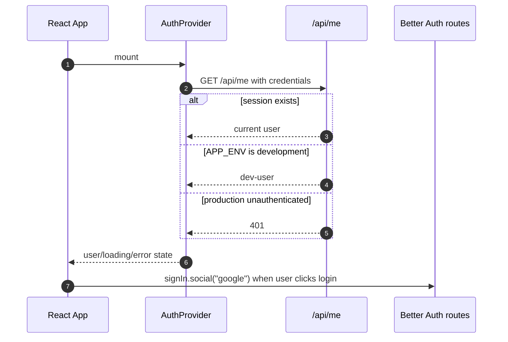
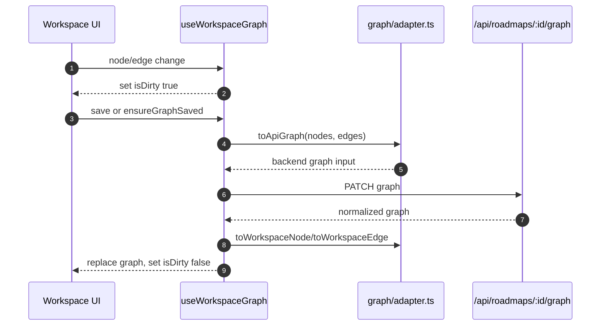

# Open Roadmap Frontend Architecture

This document describes the current `src/frontend` React app. It focuses on
where state lives, how screens compose, how the graph workspace talks to the
backend, and what to check before extending UI behavior.

## Summary

The active frontend is the React app under `src/frontend`. It is built by the
root `npm run build:frontend` script and emitted into `dist/client`, which the
Cloudflare Worker serves through the `ASSETS` binding.

The frontend is a browser-only app with these main responsibilities:

- Authenticate or fall back to the development user through `/api/me`.
- Let users create, update, delete, and open roadmaps.
- Provide a full-screen React Flow workspace for graph editing.
- Upload and attach artifacts to graph nodes.
- Publish a roadmap and select public artifacts.
- Render public profile and public roadmap pages.

## Entrypoints and Build Path

| Layer | File | Responsibility |
| --- | --- | --- |
| Root HTML | `index.html` | Points Vite at `src/frontend/src/main.tsx` for root dev/build. |
| Frontend HTML | `src/frontend/index.html` | Package-local Vite entry when running inside `src/frontend`. |
| Frontend main | `src/frontend/src/main.tsx` | Creates the React root and imports global CSS. |
| Frontend app | `src/frontend/src/app/App.tsx` | Defines route tree and wraps routes in `AuthProvider`. |
| Root Vite config | `vite.config.ts` | Root dev server and `dist/client` build output. |
| Frontend Vite config | `src/frontend/vite.config.ts` | Figma-derived app config with React, Tailwind v4, and `/api` proxy. |

The root package currently builds the frontend with:

```bash
npm --prefix src/frontend run build -- --outDir ../../dist/client --emptyOutDir
```

Then `wrangler.jsonc` serves `dist/client` through `ASSETS`, with `/api/*`
configured to run the Worker first.

## Route Tree

`src/frontend/src/app/App.tsx` owns browser routing:

| Route | Component | Auth | Purpose |
| --- | --- | --- | --- |
| `/` | `LoginRoute` | Redirects if signed in | Login screen or redirect to dashboard. |
| `/dashboard` | `DashboardPage` | Required | Roadmap list, create/edit/delete actions. |
| `/workspace` | `Navigate` | Required | Redirects to `/dashboard`. |
| `/workspace/:roadmapId` | `Workspace` | Required | Full-screen graph editor. |
| `/settings` | `SettingsPage` | Required | Profile settings and public profile link. |
| `/u/:handle` | `PublicProfile` | Public | Public user profile and published roadmap list. |
| `/r/:slug` | `PublicRoadmap` | Public | Public graph view and public artifacts. |
| `*` | `Navigate` | Public | Redirects to `/`. |

`RequireAuth` waits for `AuthProvider` to finish `/api/me`, then redirects
unauthenticated users to `/`. In local development, `/api/me` usually returns
the backend's deterministic `dev-user`.

## Auth Flow



Important files:

- `src/frontend/src/app/auth/AuthProvider.tsx`
- `src/frontend/src/app/auth/LoginRoute.tsx`
- `src/frontend/src/app/auth/RequireAuth.tsx`
- `src/frontend/src/lib/auth-client.ts`

## API Client Boundary

`src/frontend/src/lib/api.ts` is the only browser API wrapper. It keeps fetch
usage consistent:

- Always sends `credentials: "include"`.
- Sends `Content-Type: application/json` unless the body is `FormData`.
- Parses JSON safely.
- Throws `ApiError` with HTTP status and backend `{ error }` message.

When adding frontend API calls, add them to this object instead of scattering
raw `fetch` calls through components.

The active client currently exposes profile, roadmap, graph, publish, artifact,
and public read calls. It does not expose the backend agent endpoint yet.

## Screen Composition

### Dashboard

`DashboardPage` is the stateful container. It:

- Loads owned roadmaps via `api.listRoadmaps`.
- Creates roadmaps with `api.createRoadmap`.
- Updates titles and summaries with `api.updateRoadmap`.
- Deletes roadmaps with `api.deleteRoadmap`.
- Navigates into `/workspace/:roadmapId`.

`Dashboard` is the presentational screen with dialogs and cards. It also renders
the current `AIChat`, although that chat is not wired to the backend.

### Workspace

`Workspace` is the main graph-editing surface. It composes:

| Component | Purpose |
| --- | --- |
| `GraphCanvas` | Full-screen React Flow viewport wrapper. |
| `Sidebar` | Roadmap navigation and dashboard/settings links. |
| `SaveStatus` | Dirty/saving/error display and manual save action. |
| `EditPanel` | Node creation, node editing, edge editing, artifact attachment. |
| `PublishPanel` | Public title, slug, summary, artifact selection, publish action. |
| `PublishPreview` | Modal preview of the public graph. |
| `AccountButton` | Profile and sign-out menu. |
| `AIChat` | Floating chat input, currently UI-only. |
| `RoadmapDeleteDialog` | Workspace-level delete confirmation. |

`Workspace` delegates graph state to `useWorkspaceGraph`, then passes handlers
down to the panels and canvas.

### Public Screens

`PublicProfile` loads `/api/public/users/:handle` and displays the profile plus
published roadmaps.

`PublicRoadmap` loads `/api/public/roadmaps/:slug`, adapts the graph into React
Flow nodes/edges, renders a read-only `GraphViewport`, and lists public
artifacts.

## Workspace Graph State

`src/frontend/src/app/graph/useWorkspaceGraph.ts` is the central workspace
state hook. It owns:

- Current roadmap.
- Sidebar roadmap list.
- Current graph nodes and edges.
- Current artifact list through `useWorkspaceArtifacts`.
- Selection state for nodes and edges.
- Dirty/saving/error state.
- Create, update, delete, connect, save, and publish-supporting callbacks.

Initial load does three requests in parallel:

```ts
Promise.all([
  api.getRoadmap(selectedRoadmap),
  api.getGraph(selectedRoadmap),
  api.listRoadmaps(),
])
```

Save flow:



`ensureGraphSaved` is used before uploads and publishing so backend operations
that reference node IDs see the latest graph.

## React Flow Graph Components

`GraphViewport` wraps `@xyflow/react` with project defaults:

- Custom node types from `graphNodeTypes`.
- Loose connection mode.
- `fitView`, min/max zoom, background, controls, minimap.
- Optional read-only flags for public and preview views.

Custom node components:

| Node type | Component | Notes |
| --- | --- | --- |
| `objective` | `ObjectiveNode` | Wider node with target icon and objective status pill. |
| `milestone` | `MilestoneNode` | Milestone date and completed indicator. |
| `event` | `EventNode` | Progress event with optional date. |
| `artifact` | `ArtifactNode` | Artifact-style node with attachment count. |

`NodeHandles` renders source and target handles for `top`, `right`, `bottom`,
and `left`. The target handles are visually hidden but still allow loose
connections. The backend persists handle IDs in edge metadata.

## Graph Adapter Boundary

The frontend and backend intentionally use different graph shapes:

- React Flow nodes use `data.label`.
- Backend graph nodes use `data.title`.
- Frontend-only fields such as `date` and `attachments` are stored in
  backend `data.metadata`.
- Edge descriptions are stored in `edge.data.metadata.description`.
- Edge handle IDs are stored both as top-level React Flow handle fields and in
  backend metadata so they survive persistence.

All conversions live in `src/frontend/src/app/graph/adapter.ts`. Do not bypass
this file when saving or restoring workspace graphs.

For the full graph contract, see [Graph Contract](./graph-contract.md).

## Artifact State

`useWorkspaceArtifacts` owns browser artifact state for the workspace. It:

- Uploads files through `api.uploadArtifact`.
- Attaches existing artifacts to a node with `api.updateArtifact`.
- Detaches artifacts by sending `{ nodeId: null }`.
- Deletes artifacts with `api.deleteArtifact`.
- Updates local public/private visibility after publishing.
- Locally detaches artifacts when a node is removed from the unsaved graph.

Artifact upload and attach call `ensureGraphSaved` first. This matters because
the backend validates that the target node exists in D1 before accepting a node
attachment.

Current limitation: the UI only supports file uploads even though the database
has `link` and `text` artifact kinds.

## Publishing Flow

`PublishPanel` collects:

- Public title.
- Public slug.
- Public summary.
- Artifact IDs that should become public.

`Workspace.handlePublishRoadmap` calls `graph.ensureGraphSaved()` before
`api.publishRoadmap`. On success, the workspace updates:

- Current roadmap metadata.
- Sidebar roadmap list metadata.
- Local artifact `isPublic` flags.
- Published slug shown in the panel.

`PublishPreview` is a modal graph preview. It does not write anything by
itself; it delegates publish confirmation back to `Workspace`.

## Styling and UI Primitives

Global CSS import order is:

```css
@import './fonts.css';
@import './tailwind.css';
@import './theme.css';
```

Key rules:

- `theme.css` defines design tokens and Tailwind v4 `@theme inline` mappings.
- `tailwind.css` uses `@source '../**/*.{js,ts,jsx,tsx}'`.
- Shared shadcn/Radix-style primitives live in
  `src/frontend/src/app/components/ui`.
- Use local primitives such as `Button`, `Dialog`, `Input`, `Textarea`,
  `Label`, and `Badge` when a screen already uses them.
- Use `lucide-react` for icons.

The workspace intentionally has an operational tool feel: compact controls,
floating panels, clear scan hierarchy, and minimal decorative layout.

## Current Gaps

- `AIChat` only logs the input and clears the field. It needs roadmap context,
  selected artifact selection, loading/error state, and a client method for
  `/api/roadmaps/:id/agent/messages`.
- Custom node/edge type creation is available in the backend but not surfaced
  in the current workspace editor.
- Public graph pages render the full graph but do not generate thumbnail cards
  for profile roadmap listings.
- There is an `Inspector` component in `components/Inspector.tsx`, but the
  current `Workspace` uses `EditPanel` instead.
- There is no frontend read flow for AI conversation history.

## Change Checklist

When modifying frontend behavior:

1. Identify whether the change belongs in a stateful page container, a
   presentational component, or a graph hook.
2. Add API calls only through `src/frontend/src/lib/api.ts`.
3. If a graph field changes, update `adapter.ts`, `types.ts`, and
   [Graph Contract](./graph-contract.md).
4. If the change touches React Flow node visuals, update the specific node
   component and keep `graphNodeTypes` stable.
5. If a new control should be reusable, prefer `components/ui` primitives or
   existing wrappers.
6. Add or update focused tests under the relevant graph or component area.

